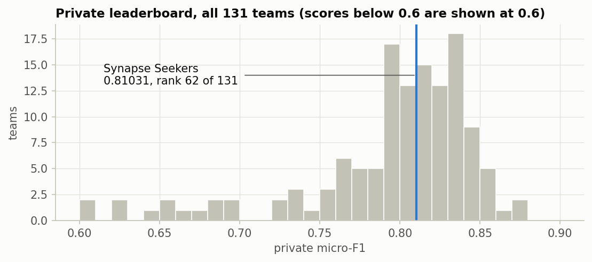
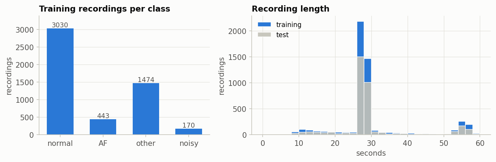
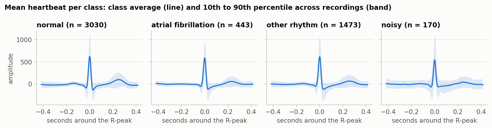

# Heart Rhythm Classification from raw ECG recordings

[](https://github.com/sourcherry7/ecg-rhythm-classification/actions/workflows/ci.yml)

Solution of **team Synapse Seekers** (Paul M. Reisenberg, Stefan Visnjic, Raphael Baudeu) to *Task 2: Heart Rhythm
Classification*, the second of three graded Kaggle competitions of the ETH Zurich course *Advanced Machine Learning*
(autumn 2024). Final standing on the private leaderboard: **62nd of 131 teams, micro-F1 = 0.81031** (median 0.809,
winner 0.874).



A mid-table result, published anyway: this repository is a clean, tested and reproducible port of the pipeline the
team selected on 2 December 2024, rebuilt from the original notebooks two years later. The defaults of
`ecg_rhythm.config.PipelineConfig` *are* the submitted configuration, including a sampling-rate mistake the team
noticed on the last day and never fixed. Run with the 2024 library versions on the team's own feature tables, the
port reproduces one of the team's uploads to the last digit (public 0.79640, private 0.79430, entry of 26 November);
it then rebuilds the features from the raw recordings and measures what the fix is worth, all verified on Kaggle's
private test set with late submissions (see [Results](#results)).

## The task

Single-lead ECG recordings sampled at 300 Hz, between 8 and 59 s long (median 28 s), each to be assigned to one of
four classes: 0 normal rhythm, 1 atrial fibrillation, 2 other rhythm, 3 too noisy to classify (the labels of the
PhysioNet/CinC 2017 challenge). 5117 labelled recordings for training, 3411 to predict; the classes are imbalanced
(3030 / 443 / 1474 / 170). The metric is the micro-averaged F1, which for a single-label problem equals accuracy, so
the small classes count little. The data is private and not part of this repository (see `data/README.md`).



## The solution

| step | what the submitted pipeline does | where |
|---|---|---|
| 1. features | For every recording, `neurokit2.ecg_process` (peak detection, cleaning, quality) and the NeuroKit2 HRV indices (time domain, frequency domain, non-linear: Poincaré, entropies, DFA), plus signal statistics, a Welch spectrum summary, sample/approximate/Shannon entropies of the raw samples, R-peak indicator statistics and a signal-quality index: 113 columns with the NeuroKit2 of 2024 (version 0.3 adds four symbolic-dynamics indices, 117). NeuroKit2 was told the sampling rate is **250 Hz** although it is 300 Hz. | `ecg_rhythm.features.hr_features` |
| 2. cleaning | Columns with at least half NaN are dropped (20 of 113, mostly indices that need a 5-minute recording), ±inf becomes NaN, NaN becomes the column mean, values are clipped to ±1e15. Train and test tables were cleaned independently. | `ecg_rhythm.features.FeatureCleaner` |
| 3. mean heartbeat | The average of all 0.5 s windows (at the 250 Hz setting: 125 samples before and after) around the detected R-peaks, 250 values per recording, appended to the features. | `ecg_rhythm.features.mean_wave` |
| 4. model | `SimpleImputer(mean)` → `StandardScaler` → `XGBClassifier()` with library defaults (100 trees, depth 6, learning rate 0.3), fitted on all 5116 usable training recordings. | `ecg_rhythm.model` |

Two recordings misbehave at the 250 Hz setting: no heartbeat can be averaged for training recording 1870 (dropped) and
test recording 700 (given the heartbeat of recording 701). In the 2024 run (NeuroKit2 0.2.10) about 2 % of the recordings made NeuroKit2 fail altogether (106 training and 51 test recordings); they received a copy of the previous recording's features. NeuroKit2 0.3.0 fails on only 6 training and 3 test recordings at the 300 Hz setting, 12 training and 6 test recordings at the 250 Hz setting. All of this is reproduced faithfully and
switchable.



## Results

Scores are micro-F1. Cross-validation is the team's 2024 protocol: 5 stratified folds without shuffling on the 5116
training recordings, feature cleaning fitted on the full table beforehand. Kaggle scores come from late submissions
(post-competition uploads scored on the same private test rows; they do not change the official rank).
All numbers come from `results/cv_scores.json` and `results/late_submissions.md` in this repository.

| run | features | CV micro-F1 | per-class F1 (normal / AF / other / noisy) | Kaggle public | Kaggle private |
|---|---|---|---|---|---|
| **submitted**, current libraries | the team's 2024 tables | 0.785 ± 0.015 | 0.86 / 0.71 / 0.65 / 0.44 | 0.79350 | 0.80497 |
| **submitted**, 2024 libraries (xgboost 2.1.2, NeuroKit2 0.2.10) | the team's 2024 tables | – | – | 0.79640 | 0.79430 |
| **submitted**, current libraries | re-extracted at 250 Hz | 0.793 ± 0.013 | 0.87 / 0.73 / 0.67 / 0.44 | 0.79756 | 0.80082 |
| corrected_rate, current libraries | re-extracted at 300 Hz | 0.798 ± 0.004 | 0.87 / 0.75 / 0.67 / 0.50 | 0.80278 | 0.80972 |
| no_mean_wave (cross-validation only) | the team's 2024 tables | 0.778 ± 0.003 | 0.86 / 0.69 / 0.64 / 0.48 | – | – |
| no_mean_wave (cross-validation only) | re-extracted at 250 Hz | 0.785 ± 0.008 | 0.86 / 0.70 / 0.65 / 0.46 | – | – |
| lgbm (cross-validation only) | the team's 2024 tables | 0.789 ± 0.013 | 0.87 / 0.71 / 0.66 / 0.39 | – | – |

- The entry the team selected in 2024 scored 0.79002 public / 0.81031 private.
- `submission_py310_2024libs.csv` scores exactly like the team's 2024 entries 9 and 10 of 2024-11-26, 2024-11-27 (public 0.79640, private 0.79430): the port reproduces that upload to the last digit.
- The entry selected for the leaderboard was a later variant of the same pipeline whose exact settings were not
  recorded; its advantage over the reproduced upload on the private half (0.016) is within the spread of the team's
  own variants, which ranged from 0.787 to 0.814 private on the last five days.

### What was submitted in 2024

Three lines of work show up in the history: a gradient-boosting classifier on hand-made BioSPPy features
(entries 1 to 4, public 0.72 to 0.73), the NeuroKit2 feature set that grew from 71 to 113 columns with the mean
heartbeat added on 26 November (entries 5 to 16, public up to 0.80), and on the last weekend a solution adapted from
a previous year's public repository (entry 18, public 0.80278, private 0.81446, the best score the team ever had).
Private scores were hidden at the time. On the final morning the team chose to stand by its own pipeline rather than
submit someone else's, and selected an entry of 30 November: public 0.79002, private 0.81031, rank 62. The defaults of
this package reproduce that pipeline.

The team uploaded 20 entries (`results/team_submissions_2024.csv`). The selected one scored 0.79002 public / 0.81031 private; the best private score of all entries was 0.81446 (entry 18), the best public score 0.80278 (entry 18).

| n | date (UTC) | file | public | private |
|---|---|---|---|---|
| 1 | 2024-11-12 03:48 | submission.csv | 0.71867 | 0.74807 |
| 2 | 2024-11-23 12:51 | X_test_predictions.csv | nan | nan |
| 3 | 2024-11-23 13:37 | X_test_predictions.csv | 0.73491 | 0.76111 |
| 4 | 2024-11-23 13:58 | X_test_predictions.csv | 0.73317 | 0.76467 |
| 5 | 2024-11-25 17:30 | predictions.csv | 0.75928 | 0.75518 |
| 6 | 2024-11-26 17:02 | predictions.csv | 0.77552 | 0.79371 |
| 7 | 2024-11-26 17:12 | predictions.csv | 0.77146 | 0.78956 |
| 8 | 2024-11-26 19:27 | predictions.csv | nan | nan |
| 9 | 2024-11-26 19:31 | predictions.csv | 0.79640 | 0.79430 |
| 10 | 2024-11-27 20:07 | predictions.csv | 0.79640 | 0.79430 |
| 11 | 2024-11-27 20:55 | submission.csv | 0.74825 | 0.74925 |
| 12 | 2024-11-27 21:07 | submission_morefetures.csv | 0.63573 | 0.65145 |
| 13 | 2024-11-28 20:21 | predictions.csv | 0.78306 | 0.78719 |
| 14 | 2024-11-28 20:27 | predictions.csv | 0.79814 | 0.79964 |
| 15 | 2024-11-30 13:05 | predictions.csv | 0.79002 | 0.81031 |
| 16 | 2024-11-30 13:09 | submission.csv **(selected)** | 0.79002 | 0.81031 |
| 17 | 2024-11-30 13:10 | submission.csv | 0.78770 | 0.80616 |
| 18 | 2024-11-30 13:20 | submission.csv | 0.80278 | 0.81446 |
| 19 | 2024-12-02 08:56 | submission.csv | 0.80278 | 0.81446 |
| 20 | 2024-12-02 08:57 | predictions.csv | 0.78886 | 0.80320 |

### The sampling-rate mistake, measured

Every HRV index in milliseconds is computed from R-peak distances in samples divided by the sampling rate, so telling
NeuroKit2 250 Hz instead of 300 Hz stretches all intervals by 20 %, shifts the LF/HF frequency bands and the Welch
spectrum by the same factor, and shortens the heartbeat window from 0.5 s to 0.42 s. A tree model is insensitive to
a constant factor on a feature, which is why the mistake cost little: re-extracting the features from the raw recordings at the 250 Hz setting gives a cross-validated micro-F1 of 0.793 (per class 0.87 / 0.73 / 0.67 / 0.44), at the true 300 Hz 0.798 (per class 0.87 / 0.75 / 0.67 / 0.50); on Kaggle's private half 0.80082 vs 0.80972.

### Ablations (the team's 2024 tables, 5-fold cross-validation)

| change | CV micro-F1 | per-class F1 |
|---|---|---|
| none (submitted configuration) | 0.785 | 0.86 / 0.71 / 0.65 / 0.44 |
| LightGBM instead of XGBoost | 0.789 | 0.87 / 0.71 / 0.66 / 0.39 |
| without the mean heartbeat | 0.778 | 0.86 / 0.69 / 0.64 / 0.48 |

## Reproducing

Python 3.10 or newer; everything lives in a virtual environment inside the repository.

```
python -m venv .venv
.\.venv\Scripts\python.exe -m pip install -e ".[dev,kaggle]"     # Linux/macOS: .venv/bin/python
.\.venv\Scripts\python.exe scripts\download_data.py --from-local <folder with the three CSVs> --legacy-features <folder with the 2024 tables>
.\.venv\Scripts\python.exe scripts\reproduce.py                  # checkpoint A: the 2024 tables -> CV -> submission.csv
.\.venv\Scripts\python.exe scripts\reproduce.py --from-raw       # checkpoint B: extract the features yourself (about an hour)
.\.venv\Scripts\python.exe scripts\reproduce.py --from-raw --preset corrected_rate
```

Individual steps:

| command | what it does | time on a 12-thread laptop |
|---|---|---|
| `scripts/extract_features.py [--preset corrected_rate]` | features and mean heartbeats for all 8528 recordings; resumable per split | 52 to 79 min with 10 workers |
| `scripts/evaluate.py --preset submitted no_mean_wave lgbm` | 5-fold cross-validation on a feature folder, appended to `results/cv_scores.json` | about a minute per preset |
| `scripts/train_predict.py --features <folder>` | fits on all training recordings, writes a submission and its metadata | under a minute |
| `scripts/submit.py --yes`, `--fill` | uploads a late submission and copies its scores into `results/late_submissions.md` | seconds |

`pytest` runs in about 20 s on simulated ECGs (`neurokit2.ecg_simulate`); tests marked `needs_data` use the real
files when they are present.

## Repository layout

```
src/ecg_rhythm/      config (defaults = submitted), data, preprocessing, features, model, evaluate, pipeline, store, kaggle_local
scripts/             download_data, extract_features, evaluate, train_predict, submit, reproduce
tests/               synthetic ECGs only; needs_data tests use the real files when present
notebooks/           one executed notebook: data, features, results figures
results/             cv_scores.json, submissions + metadata, late_submissions.md, anonymised leaderboard, figures
data/                raw/ (ignored), processed/legacy_2024/ (the team's 2024 tables), processed/features_<hash>/
```

## What the team tried along the way

The original working repositories hold three weeks of experiments, listed here so the final choice has context:

- **Signal cleaning:** wavelet-based and median-filter baseline-drift removal, a 52 Hz low-pass, soft-threshold
  wavelet denoising, BioSPPy's band-pass. The submitted features used the raw signals; the cleaning chain is kept as
  the `denoised` preset.
- **Features:** R-peak statistics and Poincaré descriptors from BioSPPy, peak-interval features in the spirit of
  Aziz, Ahmed and Alouini (*Scientific Reports*, 2021), short-time Fourier transform summaries, trimmed fixed-length
  signals, and finally the NeuroKit2 HRV suite plus the mean heartbeat, grown feature by feature.
- **Models:** `HistGradientBoostingClassifier` with a random search (0.72 public), XGBoost, LightGBM and CatBoost
  on the same features, a 1-D CNN on trimmed signals (0.69), and LSTM/dense hybrids on the mean heartbeat with the
  feature vector as a second input (worse than the trees in validation).
- **Someone else's code:** a public solution from a previous year's course reached 0.80 public on this data; the team
  decided on the last morning to submit its own 0.78 entry instead. That entry rose to 0.81 on the private half.

## Caveats, stated plainly

- NeuroKit2 and Welch were given 250 Hz on 300 Hz data. Reproduced by default; `corrected_rate` fixes it, and the
  effect is measured above.
- Recordings that NeuroKit2 cannot process (about 2 % in the 2024 run, a handful with the current version) inherit the previous recording's features. The `nan_on_error`
  preset leaves them to the imputer instead (an extraction-time option: it needs its own feature extraction).
- The four "QRS interval" features are computed from NeuroKit2's 0/1 peak-indicator column, not from the peak
  positions, so they are nearly constant. They are kept because the submitted model saw them.
- The train and test tables were cleaned independently (own column selection, own means); both happen to keep the
  same 93 columns, so `clean_per_table=false` gives the same matrix.
- The 2024 cross-validation did not shuffle and fitted the cleaning before splitting; both are options.
- Micro-F1 hides the small classes: the noisy class is recognised with an F1 below 0.5 in every configuration.
- Library versions move the predictions: the same fit on the same tables with xgboost 2.1.2 / NeuroKit2 0.2.10 (2024) and with xgboost 3.2.0 / NeuroKit2 0.3.0 agrees on 93.3% of the test labels (private 0.79430 vs 0.80497). `requirements-lock.txt` pins the current environment. The current NeuroKit2 also returns four more HRV columns (symbolic dynamics) and fails on far fewer recordings, so re-extracted tables differ from the 2024 tables beyond numerical noise.

## Team and acknowledgements

Team Synapse Seekers: Paul M. Reisenberg, Stefan Visnjic, Raphael Baudeu. The competition was organised by the
ETH Zurich Advanced Machine Learning course team (autumn 2024). The original working repository with all experiments
is [`sourcherry7/AML-Projects`](https://github.com/sourcherry7/AML-Projects). Code licensed under MIT; the
competition data is subject to the competition rules and is not distributed here.
